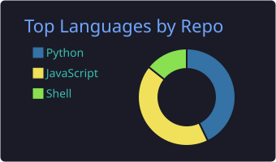
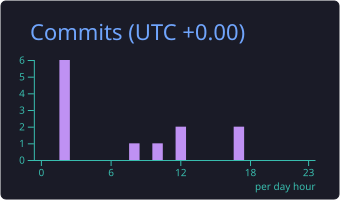

  

 

  

<a href="#-about-me">About</a> •
<a href="#-focus-areas">Focus</a> •
<a href="#-tech-stack">Stack</a> •
<a href="#-github-stats">Stats</a> •
<a href="#-lets-connect">Connect</a>

---

## 👨‍💻 About Me

I am a backend-focused software developer with a strong interest in **system design, network programming, and application security**. I enjoy understanding software at a fundamental level: how requests travel, how data is stored, and how systems can be hardened against real-world threats.

I build practical, well-structured projects, and I continuously refine my engineering skills through hands-on work and open-source tools.

---

## 🎯 Focus Areas

| 🧩 Backend Engineering | 🔐 Web Security | 🌐 Network Programming | 🐧 Linux & Open Source |
|:---:|:---:|:---:|:---:|
| REST APIs, architecture, databases | Secure coding, vulnerability research | Sockets, protocols, traffic analysis | Tooling, automation, FOSS |

---

## 🛠️ Tech Stack

**Languages**

**Backend & Frameworks**

**Databases**

**Web Servers**

**Tools & Platforms**

---

## 📊 GitHub Stats

---

## 🤝 Let's Connect

  

<i>Always learning, building, and exploring.</i>

