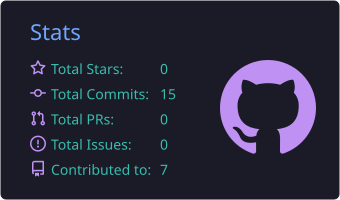
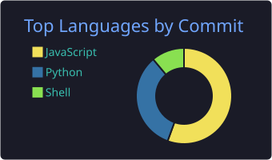

  

 

  

<a href="#-about-me">About</a> •
<a href="#-areas-of-interest">Interests</a> •
<a href="#-technical-skills">Skills</a> •
<a href="#-github-statistics">Stats</a> •
<a href="#-connect-with-me">Connect</a>

---

## 👨‍💻 About Me

I'm a backend-focused developer interested in **software engineering, cybersecurity, and network technologies**.

I enjoy building practical applications, exploring system internals, understanding communication protocols, and learning how to design and secure reliable software. My primary focus is backend development and cybersecurity, with a strong interest in Linux, networking, and open-source technologies.

---

## 🎯 Areas of Interest

| 🧩 Backend & Architecture | 🔐 Web App Security | 🌐 Network Programming | 🐧 Linux & Automation | 🌍 Open Source |
|:---:|:---:|:---:|:---:|:---:|
| Backend engineering, system design | Cybersecurity, vulnerability research | Protocol analysis, traffic inspection | Linux systems, scripting | Open source software |

---

## 🛠️ Technical Skills

### Programming Languages

### Backend Development

 

### Databases

### Networking & Web Technologies

 

### Cybersecurity & Security Tools

 

### Operating Systems & Tools

 

---

## 📊 GitHub Statistics

---

## 🚀 Current Interests

- 🛡️ Building secure backend applications
- 🔍 Exploring web vulnerabilities in authorized environments
- 📡 Network programming and traffic analysis
- 🏠 Developing lightweight and self-hosted applications
- 🐧 Exploring Linux internals and system security

---

## 🤝 Connect With Me

  

<i>Building, breaking, understanding, and improving systems.</i>

